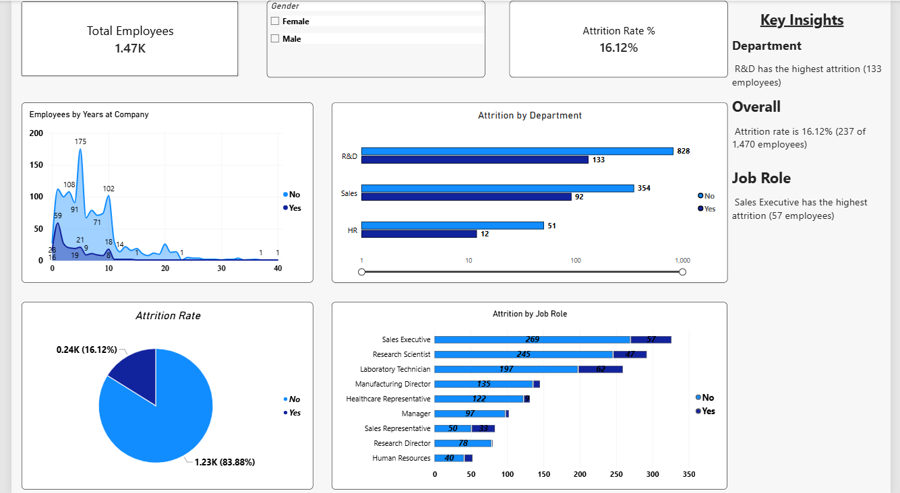

# HR-Attrition-Analysis-SQL-
End-to-end HR attrition analysis using SQL Server on 1,470 employee records: overall attrition rate, department/job role/age/tenure/income-wise breakdown, key drivers (overtime, job satisfaction, work-life balance, promotion gap, distance from home) and a risk-score based list of high-risk current employees. Power BI dashboard included

